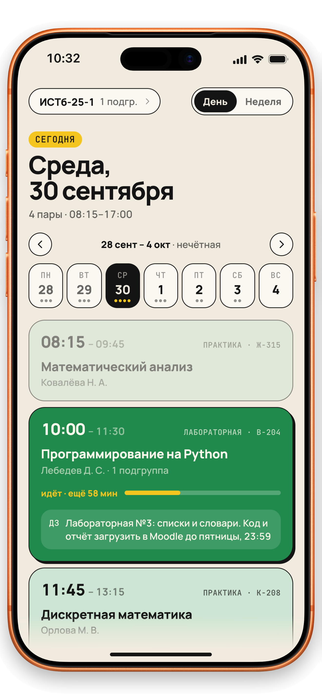
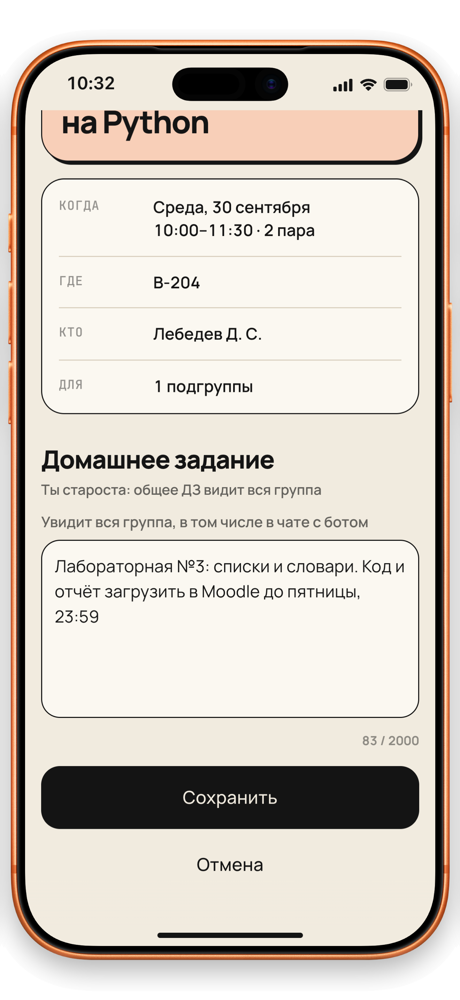
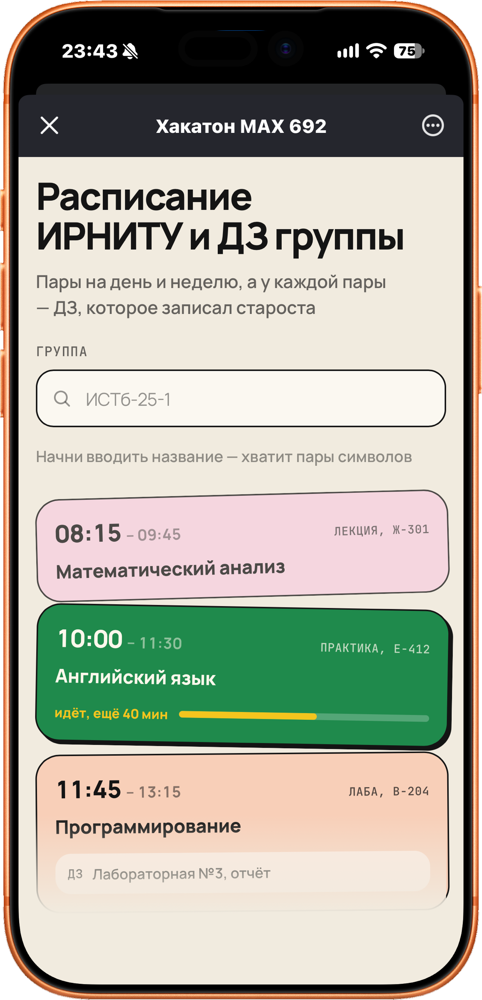
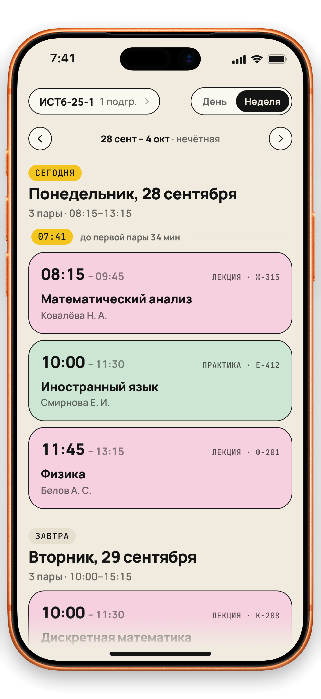
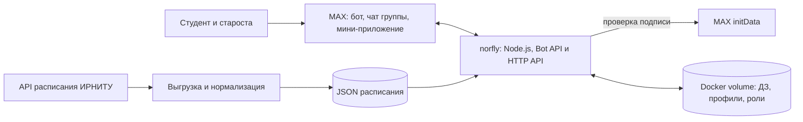

<h1 align="center">norfly</h1>

<p align="center">
  <strong>Расписание и домашние задания группы — прямо в MAX.</strong>
</p>

<p align="center">
  norfly — мини-приложение и бот для студентов ИРНИТУ и БГУ. Оно связывает пару,
  аудиторию, домашнее задание и напоминание в одном привычном месте — в MAX.
</p>

<p align="center">
  <a href="https://max.ru/t692_hakaton_max_bot">
    
  </a>
  <a href="https://158-160-253-148.sslip.io">
    
  </a>
</p>

<p align="center">
  
  
  
  
</p>

<p align="center">
  <a href="#-назначение">Почему</a> ·
  <a href="#-возможности">Возможности</a> ·
  <a href="#-галерея">Галерея</a> ·
  <a href="#-пошаговый-сценарий-проверки">Проверка</a> ·
  <a href="#-состав-и-архитектура">Архитектура</a> ·
  <a href="#-запуск-через-docker">Docker</a>
</p>

<p align="center">
  
  
</p>

## 🤔 Назначение

В чате группы домашнее задание быстро теряется среди сообщений, а расписание открывается отдельно. norfly собирает их в один сценарий: студент открывает нужную пару и сразу видит, что, где и к какому сроку нужно сделать.

> **Одна связка:** `пара → аудитория → домашнее задание → напоминание`.

Проект рассчитан на студентов младших курсов ИРНИТУ и старост, которые собирают учебную информацию для группы. Расписание загружается из API ИРНИТУ и публичного источника БГУ, а ДЗ можно вести в чате группы и в мини-приложении MAX.

## 🎯 Возможности

- **Расписание на день и неделю** — группа, подгруппа, чётность недели, время, аудитория и преподаватель.
- **Текущая и ближайшая пара** — студент сразу понимает, что происходит сейчас и что будет дальше.
- **ДЗ рядом с парой** — общее задание видит вся группа в чате и приложении.
- **Личная версия ДЗ** — заметка конкретного студента не меняет общую запись.
- **Роли в групповом чате** — староста назначает редакторов и управляет доступом к ДЗ.
- **Планер и объявления** — личные задачи, сообщения старосты и напоминания настраиваются отдельно для каждого студента.
- **Контрольные** — экзамены и зачёты отображаются отдельным экраном с напоминаниями.
- **Переносы и замены** — бот замечает изменения в расписании и сообщает о новой паре, аудитории или преподавателе.
- **Напоминания об отсутствии** — студент сообщает об опоздании или пропуске, а староста получает обращение и отмечает его как принятое.
- **Профиль и приглашение** — группа, уведомления, язык RU/EN, тема интерфейса, удаление данных и ссылка для одногруппников.

## 🧭 Основной пользовательский сценарий

1. Студент открывает бота в MAX, выбирает вуз, находит `ИСТб-25-1` и выбирает подгруппу.
2. На «Главной» видит ближайшую пару, задачи и объявления; в «Расписании» переключает день и неделю.
3. Староста или редактор выбирает пару и добавляет общее домашнее задание.
4. Студент видит ДЗ рядом с парой, сохраняет личную версию и настраивает напоминание в планере.
5. Если планы меняются, студент сообщает об опоздании или отсутствии, а староста подтверждает обращение.

## 📱 Галерея

<table align="center">
  <tr>
    <td></td>
    <td></td>
  </tr>
  <tr>
    <td></td>
    <td></td>
  </tr>
</table>

<p align="center"><sub>Интерфейс показан на демонстрационных данных: даты, имена, пары и тексты заданий не являются данными реальных студентов.</sub></p>

## 🚀 Пошаговый сценарий проверки

На первом слайде презентации указываются выпущенный коммит и ссылка на бот. Доступ к закрытой демо-группе выдаёт команда; токены и ключи на слайдах не публикуются.

**Основной сценарий: студент**

1. Откройте [бота norfly в MAX](https://max.ru/t692_hakaton_max_bot), нажмите «Начать» и кнопку «Открыть приложение».
2. Введите `истб 25`, выберите **ИСТб-25-1** и **1 подгруппу**.
   *Ожидается:* вкладка «Главная» показывает текущую или ближайшую пару с аудиторией и преподавателем, ниже — задачи и объявления.
3. Вкладка «Расписание»: переключите «День / Неделя», откройте карточку пары.
   *Ожидается:* время, аудитория, преподаватель и ДЗ группы к этой паре; внизу — время последнего обновления данных ИРНИТУ.
4. В карточке пары нажмите «Записать себе», напишите текст и сохраните.
   *Ожидается:* личная версия ДЗ видна только вам, общее ДЗ группы не меняется.
5. Вкладка «Планер» → «+ ДЗ»: выберите пару, текст и напоминание.
   *Ожидается:* задача появляется в планере и на «Главной», в назначенное время бот присылает напоминание.
6. Напишите боту `/today`, `/week`, `/homework`.
   *Ожидается:* те же пары и ДЗ, что в приложении.

**Групповой сценарий: староста и группа**

Вариант А — готовый демо-чат по ссылке с первого слайда: бот уже подключён, ДЗ заполнено.

Вариант Б — свой чат, 2 минуты:

1. Создайте чат в MAX, добавьте `@t692_hakaton_max_bot` и сделайте его администратором.
2. Напишите `/setup` и выберите **ИСТб-25-1**.
3. Напишите `/headman` и выберите себя из списка участников — вы станете старостой. Один раз нажмите «Начать» в личном чате с ботом, чтобы получать сообщения старосты.
4. Напишите `/add`, выберите пару и отправьте текст задания.
   *Ожидается:* ДЗ появляется в чате группы, у пары в мини-приложении и в `/homework` у всех участников.
5. В мини-приложении откройте вкладку «Староста» → «Объявления», опубликуйте объявление.
   *Ожидается:* сообщение в чате группы и в личном чате у каждого, кто запускал бота.
6. От имени студента на «Главной» нажмите «Опоздаю» и выберите причину.
   *Ожидается:* староста получает сообщение с кнопкой «Принято», во вкладке «Староста» появляется запись.

**Ошибки и восстановление**

- Группа не найдена: приложение показывает «Ничего не нашлось» и предлагает изменить запрос.
- API ИРНИТУ недоступен: показывается последнее сохранённое расписание и время его обновления.
- Приложение открыто вне MAX: расписание работает, для ДЗ приложение просит открыть его из бота.
- Кнопка без нужных прав в чате группы: бот отвечает коротким уведомлением и ничего не меняет.

## 💬 Команды MAX

| Сценарий | Команда |
|---|---|
| Расписание на сегодня, завтра или неделю | `/today`, `/tomorrow`, `/week` |
| ДЗ и личная версия задания | `/homework`, `/add` |
| Объявления старосты | `/news` |
| Сообщить об опоздании или отсутствии | `/absence` |
| Найти группу, преподавателя или аудиторию | `/find` |
| Настройки, язык и мои данные | `/settings` |
| Привязать чат к учебной группе | `/setup` |
| Управление группой и ролями | `/manage`, `/headman`, `/editor`, `/team`, `/access` |
| MAX ID пользователя / ID чата (только администраторы) | `/id` |
| Справка и язык чата | `/help`, `/language` |

Все действия доступны и кнопками, команды вводить не обязательно.

## 🧩 Состав и архитектура



| Компонент | Путь | Роль |
|---|---|---|
| Мини-приложение | `webapp/` | React 19, TypeScript, `@maxhub/max-ui`, MAX Bridge. Главная, расписание, карточка пары, планер, профиль, вкладка старосты |
| Бот | `src/bot/` | Личный чат и чат группы: расписание, ДЗ, роли, объявления, опоздания |
| Уведомления | `src/services/notification-service.js`, `src/services/reminder-service.js` | Напоминания о парах, сводка в 20:00, новое ДЗ, переносы и замены |
| Клиент ИРНИТУ | `src/irnitu/`, `src/services/schedule-service.js` | Запросы к API, кэш, повторы, нормализация расписания |
| Выгрузка расписания | `scripts/export-schedule.js` | Ближайшие 2 недели — каждые 3 часа, весь семестр — раз в неделю |
| HTTP-сервер | `src/http/` | Раздаёт мини-приложение, `/health` и `/api/*` с проверкой подписи `initData` MAX |
| Хранилища | `src/storage/` | JSON-файлы с профилями и данными групповых чатов |
| Развёртывание | `Dockerfile`, `compose.yaml`, `scripts/docker-start.sh` | Один контейнер: мини-приложение, API, бот и выгрузка расписания |

Контракт API — [`openapi.yaml`](openapi.yaml), обязательные проверки — [`DATA-API.yaml`](DATA-API.yaml). Рабочий адрес API: `https://158-160-253-148.sslip.io`.

## 🛠️ Запуск через Docker

Нужен Docker с Compose v2.

```bash
cp .env.example .env
```

Заполните в `.env` `BOT_TOKEN` и `IRNITU_API_TOKEN` (передаются владельцем отдельно), затем одна команда запускает всё:

```bash
docker compose up --build
```

После запуска:

- бот начинает отвечать в MAX;
- мини-приложение открывается на http://localhost:3000;
- `http://localhost:3000/health` отвечает `{"status":"ok"}`;
- расписание семестра выгружается за 15–20 минут, затем ближайшие 2 недели обновляются каждые 3 часа.

Остановка и повторный запуск:

```bash
docker compose down        # остановить, данные остаются в томе norfly-data
docker compose up -d       # запустить снова в фоне
docker compose logs -f     # смотреть логи
```

Для одного токена бота должен работать один экземпляр: перед локальным запуском с рабочим токеном остановите другой процесс с этим же токеном.

## 🖥️ Параметры окружения

- Docker Engine с Docker Compose v2. Для разработки без Docker — Node.js 22 (минимум 20).
- Около 512 МБ свободной памяти и 1 ГБ места на диске: образ весит примерно 240 МБ, расписание семестра — около 90 МБ.
- Исходящий доступ в интернет к MAX Bot API (`platform-api2.max.ru`) и API ИРНИТУ (`schedule.istu.edu`).
- Часовой пояс контейнера — `Asia/Irkutsk`, задан в `Dockerfile`.
- Для кнопки мини-приложения внутри MAX нужен публичный HTTPS-адрес (`MINI_APP_URL`). Локально приложение открывается по HTTP в браузере.

## ⚙️ Переменные окружения

| Переменная | Обязательна | По умолчанию | Назначение |
|---|---|---|---|
| `BOT_TOKEN` | да | — | Токен бота MAX, выданный организаторами |
| `IRNITU_API_TOKEN` | да | — | Токен API расписания ИРНИТУ. Без него приложение откроется без расписания |
| `IRNITU_API_URL` | нет | `https://schedule.istu.edu/api/` | Адрес API ИРНИТУ |
| `IRNITU_TIMEOUT_MS` | нет | `6000` | Таймаут запроса к ИРНИТУ |
| `IRNITU_RETRIES` | нет | `1` | Число повторов запроса к ИРНИТУ |
| `CACHE_DIR` | нет | `./data/cache` | Кэш ответов ИРНИТУ |
| `PORT` | нет | `3000` | Порт HTTP-сервера в контейнере |
| `HOST_PORT` | нет | `3000` | Порт на машине для `docker compose` |
| `MINI_APP_URL` | нет | `https://158-160-253-148.sslip.io` | Публичный HTTPS-адрес мини-приложения |
| `MINI_APP_BUTTON` | нет | `app` | `app` — кнопка открывает мини-приложение внутри MAX с авторизацией; `link` — обычная ссылка (расписание работает, ДЗ — нет) |
| `API_ACCESS_KEY` | нет | — | Служебный ключ для проверки справочников и расписания через API |
| `INIT_DATA_MAX_AGE_SEC` | нет | `86400` | Срок действия подписи `initData` MAX |
| `DEV_USER_ID` | нет | — | Тестовый пользователь для локальной разработки, в `production` не действует |
| `EXPORT_INTERVAL_SEC` | нет | `10800` | Период обновления ближайших недель |
| `EXPORT_FULL_INTERVAL_SEC` | нет | `604800` | Период выгрузки всего семестра |
| `EXPORT_WEEKS` | нет | `2` | Сколько ближайших недель обновлять |

`.env` исключён из Git, в репозитории только `.env.example` без рабочих значений.

## 🔌 Порты

| Порт | Что |
|---|---|
| `3000` | HTTP-сервер: мини-приложение, `/health`, `/api/*` |

Бот подключается к MAX сам (long polling), входящие порты ему не нужны. На рабочем сервере HTTPS принимает обратный прокси и передаёт запросы на порт 3000.

## 📦 Зависимости

| Часть | Технологии | Где зафиксированы версии |
|---|---|---|
| Бот и API | Node.js 22 (минимум 20), `@maxhub/max-bot-api`, `dotenv` | `package-lock.json` |
| Мини-приложение | React 19, TypeScript, `@maxhub/max-ui`, Vite | `webapp/package-lock.json` |
| Интеграция с MAX | MAX Bridge (`https://st.max.ru/js/max-web-app.js`) | подключается платформой MAX |
| Запуск | Docker, Docker Compose v2 | `Dockerfile`, `compose.yaml` |

## 🌐 Внешние сервисы и интеграции

| Сервис | Для чего | Интеграция |
|---|---|---|
| MAX Bot API | Бот в личном чате и в чатах групп | реальная |
| MAX Bridge | Данные пользователя, кнопка «Назад», вибрация, параметр `startapp` | реальная |
| API расписания ИРНИТУ (`schedule.istu.edu`) | Группы, преподаватели, аудитории, пары | реальная, доступ предоставлен университетом |
| Yandex Cloud | HTTPS-хостинг бота, API и мини-приложения | реальная |

Сертификат `platform-api2.max.ru` выдан российским удостоверяющим центром Минцифры, поэтому в репозитории лежит публичный корневой сертификат `certs/russian_trusted_root_ca.pem`. В Docker он подключается через `NODE_EXTRA_CA_CERTS`. Для живых запросов API ИРНИТУ нужен серверный токен; он не включается в образ и презентацию. Автономные сценарии и фикстуры работают без токена.

## 🔐 Работа с данными

- **Расписание** — настоящее, из API ИРНИТУ. В приложении указано время последнего обновления.
- **Общее ДЗ** хранится для учебной группы: менять его могут староста и редакторы. **Личное ДЗ** видно только владельцу.
- **Профиль**: из данных MAX сохраняются только ID пользователя, имя и выбранная группа. Телефон, контакты и переписку бот не получает.
- **Где хранятся данные**: сервер в Yandex Cloud, зона `ru-central1-d`, регион Россия. Резервные копии после подключения Object Storage хранятся в том же регионе с репликацией между зонами.
- **Сообщения об опоздании** не анонимные: староста видит имя студента, пару и причину. В общий чат они не попадают и хранятся в данных группы.
- **Снимки расписания** для поиска переносов — только пары групп, без персональных данных.
- **Удаление аккаунта** (в профиле приложения или «Мои данные» в боте) стирает профиль, настройки, личное ДЗ и напоминания и снимает роли.
- API принимает только запросы с подписью `initData` MAX; служебный ключ открывает только справочники и расписание.
- Даты пар и ввод срока относятся к вузу (Asia/Irkutsk); отображение, напоминания и тихие часы используют IANA-пояс профиля.

## 🧪 Тестовые данные

- Учебные группы получают настоящее расписание. Зарезервированная ДЕМО-25-1 имеет фиксированные занятия и доступна только разрешённым MAX ID после настройки этапа 4.
- Группа для проверки — **ИСТб-25-1**, 1 подгруппа. Записи ДЗ в ней добавлены студентами группы и командой.
- Для проверки группового сценария используйте демо-чат по ссылке с первого слайда или свой чат (вариант Б выше).
- `npm run dev` в папке `webapp/` без токена ИРНИТУ подставляет вымышленные группы `ДЕМО-25-1` и `ДЕМО-24-2`. Эти данные в рабочую сборку не попадают.

## 🧰 Разработка

```bash
npm ci && npm ci --prefix webapp
npm test                 # тесты сервера и сценариев бота
npm run dev:web          # мини-приложение на http://localhost:5173 с демо-данными
npm start                # бот и HTTP-сервер (нужен .env)
npm run export:schedule  # выгрузить ближайшие недели расписания
npm run intro --prefix webapp -- анимация.mp4  # заменить заставку первого запуска, GIF или видео (нужен ffmpeg)
```

## ⚠️ Известные ограничения

- Одно ДЗ — до 2 000 символов; файлы и фото к ДЗ пока не прикрепляются.
- Сегодня и завтра переносы и замены проверяются каждые 15 минут у активных групп; ближайшие 14 дней — раз в 3 часа. Дальние недели семестра обновляются раз в неделю.
- Для одного токена бота работает один экземпляр процесса.
- Начатый ввод в боте (текст ДЗ, причина отсутствия) хранится в памяти: после перезапуска его нужно повторить. Кнопки продолжают работать.
- Адрес мини-приложения для кнопки MAX задаётся на платформе MAX для партнёров, через Bot API его не поменять.
- Формы контроля по дисциплинам ИРНИТУ заранее не публикует, студент отмечает их сам.
- Минуты опоздания указывает студент; пропуск целой пары считается как 90 минут.
- В чате группы клиент MAX показывает команды с именем бота (`/start@t692_hakaton_max_bot`), это поведение клиента.

## 📈 План пилота

Следующий этап — шестинедельный пилот на 10–15 группах 1–2 курсов ИРНИТУ. Цели ниже — **гипотезы для проверки, а не достигнутые результаты**:

- 70% студентов находят ДЗ к паре меньше чем за минуту (до запуска 47% искали дольше 10 минут);
- вопросов «что задали?» в неделю становится вдвое меньше;
- ДЗ записано хотя бы к 50% пар;
- 70% студентов подключённой группы пользуются ботом или приложением;
- 60% групп назначают старосту в первую неделю.

Если выполнены 4 цели из 5, подключаем все 836 групп ИРНИТУ. Перед пилотом нужны согласие на обработку персональных данных при первом входе и уведомление Роскомнадзора от оператора.

## 👥 Команда

<table align="center">
  <tr>
    <td align="center" width="33%">
      <br>
      <strong>Дмитрий Гавриленко</strong><br>
      <sub>Product-менеджер</sub>
    </td>
    <td align="center" width="33%">
      <br>
      <strong>Дмитрий Иванов</strong><br>
      <sub>Fullstack-разработчик</sub>
    </td>
    <td align="center" width="33%">
      <br>
      <strong>Вячеслав Какалевский</strong><br>
      <sub>UX/UI-дизайнер</sub>
    </td>
  </tr>
</table>

---

<p align="center"><sub>norfly · Хакатон MAX 2026 · образовательные решения</sub></p>


### Переносы пары и сохранение ДЗ (этап 1)

Этап 1 выпущен на прод 18.10.2026. Проверены 69 тестов, сборка и состояние сервера. Хеш работающего образа и порядок продолжения — в [`DEPLOYMENT.md`](DEPLOYMENT.md).

При проверке расписания norfly сопоставляет исчезнувшую пару с новой: предмет, тип занятия, преподаватели и подгруппа должны совпасть. Если вариантов несколько, выбирает ближайший по времени. Вместе с парой переходят общее ДЗ, личные версии и напоминания. В истории ДЗ сохраняются старый и новый слот и источник переноса. Напоминание перед началом пары пересчитывается; напоминание на конкретное время сохраняется, пока оно в будущем.

Староста или редактор может открыть карточку пары и нажать «Пара перенесена», выбрать новую дату и пару той же подгруппы либо «Отменена». В боте: меню ДЗ группы, выбор пары, «Пара перенесена»; также `/manage`, «Пара перенесена». Отметка хранится отдельно от расписания вуза, видна группе с именем и временем, уведомление уходит в чат сразу. Повторная отметка того же переноса не создаёт уведомление. Отменить её можно из карточки новой пары; для отменённой пары — во вкладке «Староста», «ДЗ», «Отметки переносов» или через `/manage`, «Отметки переносов».

Когда вуз подтверждает перенос, norfly снимает временный оверлей без повторного уведомления. Если новое расписание отличается, применяется расписание вуза, автор отметки получает личное сообщение. До фактического изменения расписания вуза ручная отметка остаётся действующей. При совпадении ДЗ в целевом слоте оба текста сохраняются в одной записи, история объединяется.

Если перенос не найден, ДЗ получает статус `orphaned`. Студент видит в расписании дня «Пара отменена, ДЗ сохранено». Староста и редакторы открывают вкладку «Староста», «ДЗ» или `/manage`, «ДЗ отменённых пар»: общее ДЗ можно привязать к другой паре или удалить. Личные версии остаются личными. Старые JSON-записи без статуса и истории читаются без миграционного скрипта.

Расписание на сегодня и завтра проверяется каждые 15 минут только у групп с пользователем или привязанным чатом. Ближайшие 14 дней проверяются каждые 3 часа. Статическая выгрузка двух недель работает каждые 3 часа, семестра — раз в неделю. При запросе недели ботом или мини-приложением устаревшие данные возвращаются сразу, обновление идёт в фоне. Один ключ «группа + неделя» запрашивается не чаще раза в 15 минут; параллельные обращения объединяются, ошибки не вызывают поток повторов. В дне и карточке пары показан возраст успешного обновления, RU/EN. Если динамический API недоступен, мини-приложение использует статическую выгрузку.

| Переменная | По умолчанию | Назначение |
|---|---|---|
| `CHANGES_INTERVAL_MS` | `900000` | Проверка сегодня и завтра |
| `RECENT_CHANGES_INTERVAL_MS` | `10800000` | Проверка ближайших 14 дней |
| `SCHEDULE_CACHE_TTL_MS` | `900000` | Возраст недели для фонового обновления и ограничение запросов |
| `IRNITU_CONCURRENCY` | `4` | Одновременные запросы к API в процессе бота |
| `DIRECTORY_CACHE_TTL_MS` | `10800000` | Кэш справочников |
| `EXPORT_INTERVAL_SEC` | `10800` | Интервал статической выгрузки двух недель |
| `EXPORT_FULL_INTERVAL_SEC` | `604800` | Интервал выгрузки семестра |
| `EXPORT_WEEKS` | `2` | Число недель в ближайшей выгрузке |
| `EXPORT_CONCURRENCY` | `4` | Одновременные задания отдельного процесса выгрузки |

Демо без токена вуза: `npm run dev:web`, адрес Vite. `?demoUser=1` — староста, `?demoUser=2` — студент, `?demoUser=3` — редактор. Демо использует настоящие серверные маршруты и JSON-хранилища во временном каталоге. После перезапуска данные сбрасываются. Две вкладки используют общую группу; обнови страницу студента после переноса. Тексты отправленных сообщений доступны по `/api/demo/notifications`. Полный сценарий и расчёт запросов записаны в `FINAL-UPDATE.md`.

Порядок выпуска на текущую ВМ, сохранение данных, откат и передача следующему этапу — в [`DEPLOYMENT.md`](DEPLOYMENT.md).

## Выбор вуза и часовой пояс

При первом выборе группы мини-приложение предлагает ИРНИТУ или БГУ, затем группу и подгруппу. В боте после выбора языка также выбирается вуз; `/setup` в чате группы начинает настройку с вуза. `/find` использует выбранный вуз. Вуз меняют в «Профиль → Университет»; в боте — «Ещё → Вуз» или настройка группы. Старые профили и чаты автоматически относятся к ИРНИТУ и повторный выбор не требуют.

Часовой пояс устройства определяется через `Intl` и сохраняется в профиле. «Профиль → Часовой пояс» позволяет выбрать другой IANA-пояс. Бот использует профиль, а без него — пояс вуза. Пара ИРНИТУ 08:15–09:45 в Москве показывается как 03:15–04:45. В карточке остаётся подпись местного времени вуза. День интерфейса и «сегодня/завтра» относятся к пользователю; ключ даты пары и ДЗ остаётся в дате вуза.

Напоминания перед парой привязаны к моменту её начала. Сводка в 20:00 и тихие часы относятся к поясу профиля. Тихие часы включаются в настройках уведомлений, по умолчанию выключены. Во время тишины личные уведомления не отправляются; мгновенные сообщения не накапливаются, отложенные напоминания сохраняют прежнее окно обработки до шести часов. Рассылка в чат группы не зависит от тихих часов отдельного участника.

Идентификаторы групп составные: `irnitu~478237`, `bgu~32982`. Числовые id входящих API-запросов, старых кнопок и приглашений по-прежнему означают ИРНИТУ. Профили автоматически переходят на `schemaVersion: 3`, Community с вложениями — на `schemaVersion: 4`; профили теперь лежат в `preferences.json.profiles`. Миграция сохраняет ДЗ, личные версии, роли, отметки, напоминания и время снимков. Новые статические файлы находятся в `schedule/<universityId>~<sourceId>/<week>.json`; мини-приложение умеет прочитать прежнюю выгрузку ИРНИТУ.

### БГУ

Список групп — [публичное расписание БГУ](https://bgu.ru/student/timetable.aspx). Расписание загружается с [облегчённой страницы БГУ](https://bgu.ru/telek/timetable.aspx?idg=32982), преподаватели — с `/telek/timetable-pps.aspx?idp=<id>&d=ДД.ММ.ГГГГ`. Эти адреса использует и существующее студенческое приложение Northly. Токен и вход в аккаунт для этого адреса не требуются; договор о доступе не предоставлялся и для выполненных публичных GET не понадобился. Договорённость об API или гарантированной доступности не заявляется.

Провайдер читает список групп и преподавателей, расписание семестра, аудитории, тип занятия и значки чётности. По дате и чётности страницы вычисляется выбранная неделя; диапазон семестра ограничивает повторение занятий. Пояс — `Asia/Irkutsk`. Начало берётся из таблицы; обычная сетка использует пару 90 минут. Нестандартное начало получает устойчивый номер по минутам суток и `endEstimated: true` для расчётного конца через 90 минут. Это ограничение источника: HTML содержит колонку «Начало», отдельной колонки окончания нет.

Список факультетов/институтов и отдельный поиск аудиторий в исследованных страницах не найдены. Соответствующие действия скрыты. Формы контроля дисциплин, как и у ИРНИТУ, студент отмечает сам. Экзамены, зачёты и консультации из HTML относятся к общему формату занятий. [Страница пересдач](https://bgu.ru/student/peresdacha.aspx) публикует отдельные PDF по кафедрам без однозначной связи с группой, поэтому эти PDF автоматически в расписание группы не добавляются.

Фикстуры находятся в `test/fixtures/bgu/`: настоящие HTTP-ответы шести групп, две недели преподавателя и архивы Safari. Основная страница `/student/` в среде разработки возвращает недоступность; `/telek/` отдаёт свежие данные без изменения VPN, токена и браузерной автоматизации. Первоначальная резервная копия ГМУ-25-1 сохраняется с фактическим временем; ошибка источника не затирает кэш и не запускает ложные отмены. Сессия ЗНБ-23-1 проверена на настоящих экзаменах и зачётах с датами. Расписание преподавателя кэшируется отдельно для каждой недели; ответ с другой неделей отклоняется.

У БГУ одна файловая очередь для процесса бота и выгрузки: один запрос одновременно, пауза не менее 1500 мс, понятный User-Agent. `BGU_CACHE_DIR` должен быть общим для обоих процессов. Успешный HTML семестра используется для разных недель без повторной загрузки каждой недели; срок обновления — 15 минут, справочников — 3 часа. Сегодня/завтра, 14 дней и недельная выгрузка встроены в прежний цикл. БГУ выгружается только для активных групп. `robots.txt` проверен и сохранён; перед выпуском следует повторно проверить актуальные правила.

Живая проверка без MAX и токена: `npm run check:bgu -- 2026-10-19`. Команда загружает справочники, три группы и две недели преподавателя, проверяет свежесть и выводит время обновления, число занятий и пример перевода времени в Москву. Рабочие данные не меняются: кэш временный, очередь и паузы те же. При недоступности и возврате сохранённых данных код завершения — 1. Обычные `npm test` остаются независимыми от сети.

В БИ-26-1 и Л-25-1 есть одновременные строки с разными преподавателями без номера подгруппы. Они сохраняются все; провайдер не назначает номера 1/2 по порядку строк. Явно подписанные подгруппы распознаются, но такого реального примера среди шести изученных групп нет. В `robots.txt` запрет `/telek/` указан для Googlebot и YandexBot; секции для `norfly` и общей `*` нет. Провайдер использует собственный User-Agent и не представляется поисковым роботом.

### Демо без сети

Запустить `npm run dev:web`. Демо использует настоящие серверные хранилища и маршруты; временные данные удаляются при остановке Vite.

- `?demoUser=6` — новый пользователь: выбрать БГУ, найти `ГМУ`, выбрать `ГМУ-25-1` и всю группу. В «Расписании» перейти на неделю 19–25.10.2026. В понедельник три пары, первая — «Конституционное право», 14:00 по Иркутску. Вторник пустой.
- Выбрать в профиле `Europe/Moscow`: первая пара отображается в 09:00, рядом «14:00 по Иркутску». Смена пояса сохраняется на сервере.
- `?demoUser=4` и `?demoUser=5` — староста и студент БГУ; заранее задан московский пояс. При первом открытии выбрать ту же группу в локальном профиле. Отметка переноса и ДЗ общие для этих вкладок.
- В выборе БГУ также доступны БИ-26-1 (одновременные занятия) и ЗНБ-23-1 (сессия с зачётами и экзаменами).
- `?demoUser=1`, `2`, `3` — прежнее демо ИРНИТУ. Параметр пользователя сохраняется после онбординга. Даты синтетического ИРНИТУ генерируются относительно текущей недели; сохранённое расписание БГУ ограничено настоящим семестром 01.09–08.12.2026.

Скриншот проверки на ширине 375 px: `docs/images/bgu-moscow.jpg`.

## Как подключить вуз

1. Проверить источник, `robots.txt`, условия доступа, IANA-пояс, сетку пар, чётность, подгруппы и сессию. Для закрытого API получить токен у вуза. Сохранить подлинные ответы и время получения.
2. Создать `src/universities/<id>/provider.js` по контракту `src/universities/provider.js`. Вернуть группы, доступные справочники и нормализованную неделю. Разделять успешную пустую неделю, ошибку источника и неизвестную разметку. При ошибке сохранять прежний `updatedAt`; исходное расписание и ручной оверлей хранить отдельно.
3. Добавить конфиг в `src/universities/config.js`: RU/EN-названия, город, IANA, сетку, чётность, источник, доступ и возможности. Зарегистрировать провайдер в `src/index.js` и `scripts/export-schedule.js`. Для нового id расширить допустимый список в `identity.js`, схемах API и разборе payload; онбординг и скрытие возможностей также расширяются явно.
4. Пропускать внешние id через `UniversityService`: составной id группы обязателен в профилях, чатах, ДЗ, снимках, кэше, выгрузке и ссылках. Не преобразовывать составной id через `Number()`. Дату хранить по вузу, показывать через `startsAt`/`endsAt` и пояс профиля.
5. Добавить реальные фикстуры успешной недели и ошибки, тесты чётности, подгрупп, семестра, пустого дня и сессии. Проверить поиск, кэш, лимиты запросов, совпадающие числовые id, миграции, старые кнопки, выбор вуза, переносы и уведомления.
6. Добавить группу в демо, обновить README, OpenAPI, DATA-API и `.env.example`. Выполнить `TZ=UTC npm test`, `TZ=Europe/Moscow npm test`, `TZ=Asia/Irkutsk npm test`, `npm run build:web`, `ruby -ryaml -e 'ARGV.each { |p| YAML.load_file(p) }' openapi.yaml DATA-API.yaml` и `git diff --check`.

## Вложения в ДЗ

Староста и редакторы отправляют боту текст ДЗ и фото или файлы одним сообщением после выбора пары. Можно отправить только вложения. Сообщения одного автора в одном сценарии объединяются после паузы 10 секунд; отдельной команды или подтверждения нет. `/cancel` отменяет ввод. Смена сценария тоже отменяет незавершённую серию. При перезапуске незавершённый ввод нужно повторить.

В карточке пары у общего ДЗ и личной версии есть «Прикрепить»: несколько файлов, предпросмотр, удаление до сохранения. Текст и выбранные вложения сохраняются одной кнопкой. Во время загрузки виден прогресс; ошибку можно повторить или убрать файл. Фото сжимаются на устройстве до 2048 px по длинной стороне, JPEG с качеством 0,82. Если формат не декодируется устройством, показана ошибка. Изменение видно другим пользователям при открытии карточки, возвращении в приложение или очередном обновлении видимого экрана, не позднее 10 секунд при работающем соединении.

Фото открываются на весь экран; есть листание кнопками, стрелками клавиатуры и свайпом. PDF и остальные файлы показаны с именем и размером в карточке пары, задачах «Главной» и планере. В MAX используется `WebApp.downloadFile`, запасной путь — `openLink`; вне MAX — обычное скачивание. Ссылка выдаётся после проверки прав, подписана на 5 минут и работает без передачи `initData` внешнему браузеру. При выдаче файла права проверяются снова. Физические iOS/Android требуют отдельной проверки перед выпуском.

Хранение бесплатное, на диске ВМ: `ATTACHMENT_DIR`, в Docker — отдельный том `norfly-attachments` в `/app/attachments`. Байты и закрытые JSON с метаданными хранятся рядом, UUID служит именем файла. Ссылки MAX не являются хранилищем: входящие файлы копируются на ВМ до сохранения ДЗ. Токен фото используется только для повторной отправки ботом; исходный файл всегда остаётся на диске. Временная недоступность MAX не мешает открыть уже сохранённое вложение в приложении.

Лимиты задаются окружением, значения по умолчанию:

| Переменная | Значение |
|---|---|
| `ATTACHMENT_MAX_BYTES` | 10 МиБ на файл |
| `ATTACHMENT_MAX_COUNT` | 8 вложений в версии ДЗ; 8 несохранённых файлов автора в группе |
| `ATTACHMENT_TOTAL_BYTES` | 5 ГиБ на все вложения ВМ, включая несохранённые |
| `ATTACHMENT_GROUP_BYTES` | 100 МиБ на группу, включая историю, личные версии и несохранённые загрузки |
| `ATTACHMENT_RESERVE_BYTES` | 512 МиБ свободного места остаются для приложения |
| `ATTACHMENT_DIR` | `./attachments`, Docker: `/app/attachments` |

Превышение лимита не меняет сохранённое ДЗ. Поддерживаются растровые изображения, PDF, Office, UTF-8 текст, RTF, ZIP/7z/RAR/GZIP/TAR, основные видео и аудио. Тип определяется по содержимому (`file-type`); HTML, SVG, исполняемые и неизвестные форматы не принимаются. Архивы не распаковываются. Имя очищается. Файлы выдаются только выбранной группе, личные — владельцу. Всё кроме изображений отдаётся с `Content-Disposition: attachment`, также действует `nosniff`.

Перенос пары переносит ссылки на вложения вместе с ДЗ; отмена пары сохраняет файлы. При удалении ДЗ файл удаляется после сохранения JSON, если больше нигде не используется. Убранное из текущей версии вложение остаётся в истории до удаления самого ДЗ. История сохраняет снимки текста, сроков, способа сдачи и вложений. Прежние байты сохраняются для возврата версии и входят в квоты; без действующей ссылки на ДЗ они не скачиваются. Удаление ДЗ удаляет также его версии и больше не используемые байты. «Удалить мои данные» удаляет личные вложения и личные несохранённые загрузки; общее ДЗ группы сохраняется. Несохранённые загрузки и файлы без записи старше часа очищаются при запуске, после изменений ДЗ и каждые 15 минут. Для общего файла, загруженного, но не сохранённого в ДЗ, действует та же очистка через час.

Перед выпуском обязательно проверить подключение тома и включить `norfly-attachments` в согласованную копию релиза вместе с `norfly-data`. Инструкция — `DEPLOYMENT.md`. Регулярное резервное копирование и восстановление описаны ниже и в DEPLOYMENT.md; включены на проде по разрешению владельца, реальное восстановление проверено.

Демо без MAX и API вузов: `npm run dev:web`, `?demoUser=1` — староста, `?demoUser=2` — студент. Выбрать ИРНИТУ, ДЕМО-25-1, подгруппу 1. На следующей неделе в понедельник у математического анализа уже есть фото и PDF. Для выбора файлов взять `test/fixtures/attachments/board.jpg` и `method.pdf`. После изменения кода сервера перезапустить Vite. Точный сценарий переноса и проверки — в `FINAL-UPDATE.md`.

## Срок, способ сдачи и история ДЗ (этап 4)

Этап 4 выпущен 18.10.2026: `6b81ea679c2c`. Закрытое демо и MAX-оповещение копирования подключаются после передачи владельцем ID через `/id`.

В карточке пары и при создании ДЗ в планере доступны необязательные поля общего ДЗ и личной версии:

- **Срок:** по умолчанию «К этой паре»; «К следующей паре по предмету»; конкретные дата и время в часовом поясе вуза. Показ — в поясе профиля. Первый вариант следует за переносом пары, конкретная дата остаётся прежней. Следующая пара ищется в расписании ближайших восьми недель; если её нет, срок остаётся неуточнённым.
- **Способ сдачи:** на паре, Moodle, другая система, почта, другое; уточнение и HTTPS-ссылка необязательны. Схемы HTTP, javascript, file и ссылки с логином/паролем отвергаются.
- **Напоминание:** за 24 часа до срока или в 08:00 в день срока по поясу профиля. Пересчитывается при изменении срока и переносе. Существующие фиксированные напоминания сохраняют своё время. Если 08:00 в поясе студента позже срока, утреннее напоминание недоступно; прошедшее время не назначается.

«Главная», планер и `/homework` показывают срок и способ сдачи. Задачи отсортированы по сроку; просрочка обозначена текстом. Прошедшие задачи доступны в планере по дню срока и в списке текущего дня. Отметки выполнения пока нет, поэтому прошедший срок сам по себе не означает, что студент не сдал задание.

«История изменений» в карточке показывает автора, время, короткое сравнение текста, вложения, срок, способ сдачи и переносы. Общую историю видит группа; личную — только владелец. Староста и редакторы возвращают прежнюю общую версию: возврат создаёт новую версию и уведомление. Версии, созданные до этапа 4, нельзя восстановить задним числом: сохранён только фактически известный текст. При слиянии двух ДЗ в одном слоте история сохраняется, а объединённое ДЗ получает новую версию; снимки обеих историй получают однозначную нумерацию для возврата; исходные номера сохраняются в originalVersion.

В боте после обычного сохранения появляются необязательные кнопки «Срок и способ сдачи» и «История». Запись текста/фото не требует дополнительных шагов. Конкретная дата вводится только после отдельного запроса, формат `ГГГГ-ММ-ДД ЧЧ:мм`. Срок и способ из текста ДЗ не извлекаются. «История» у `/homework` показывает последние пять изменений и кнопки возврата для редакторов.

## Копии вне ВМ и закрытое демо

`ops/backup.sh` и systemd timer готовят согласованный снимок трёх томов, шифруют AES-256-GCM и отправляют в региональный Yandex Object Storage. Перед ротацией выполняются обратное скачивание, проверка аутентичности, SHA-256 всех файлов и счётчиков JSON. Хранение настраивается через `BACKUP_KEEP_DAILY` / `BACKUP_KEEP_WEEKLY`; по умолчанию 14 ежедневных и 8 еженедельных точек без дублирования одинакового архива. Ключ расшифрования хранится вне бакета. Статус — journalctl и `/var/lib/norfly-backup/last-backup.json`; ошибка отправляется `BACKUP_ADMIN_ID` в MAX после настройки ID владельца (сейчас ожидается). Timer включён: 03:00–03:05 Иркутск. Реальное восстановление 20 094 файлов с SHA-256 проверено на ВМ (37,434 с) и вне ВМ (9,355 с).

Восстановление в **новый пустой каталог**: `npm run backup:restore -- /absolute/path/restore-check`. Команда не подменяет действующие данные и не запускает бота. Конфигурация ключа и S3 должна быть доступна процессу. Полная процедура, стоимость и ограничения RPO/RTO — в `DEPLOYMENT.md`.

Прод-демо имеет id `irnitu~999999991`. Видимость задаётся `DEMO_MAX_IDS`, чат — `DEMO_CHAT_ID`. Неавторизованные пользователи и служебный Bearer не получают доступ. Запрещённый id отвечает `404 not_found`, как отсутствующая группа. Демо не экспортируется в публичные статические JSON. Сброс на сервере: `sudo sh ops/demo-reset.sh` (внутри запускается `npm run demo:reset`) из `/home/yc-user/norfly`; команда останавливает запись, очищает только демо, восстанавливает роли и исходное ДЗ к понедельнику следующей недели, затем запускает приложение. Первый ID — староста, второй — студент, остальные — редакторы. Не использовать живую учебную группу как демо-чат.
